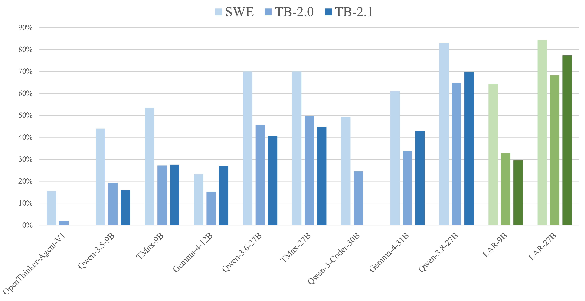
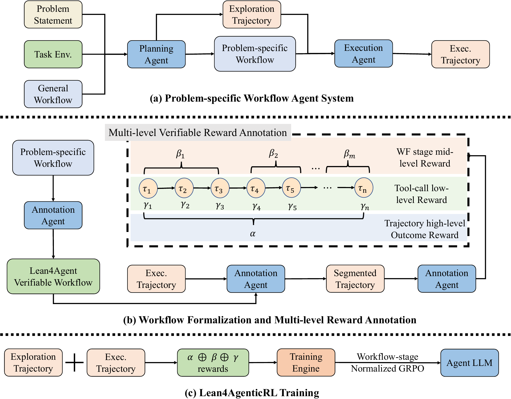

# Lean4AgenticRL

<div align="center">
  <a href="https://lean4agent.github.io/">
    
  </a>
  <a href="https://huggingface.co/amazon/LAR-27B">
    
  </a>
  <a href="https://opensource.org/license/mit">
    
  </a>
  <a href="https://www.apache.org/licenses/LICENSE-2.0">
    
  </a>
</div>

<p align="center">
  <a href="https://github.com/RickySkywalker/Lean4AgenticRL/blob/main/assets/paper.pdf"><b>Paper Link</b>👁️</a>
</p>

This is the official repository for *Lean4AgenticRL: Advancing Agentic RL with Verifiable Multi-level Process Rewards*. We achieved **77.3%** on TerminalBench-2.1 using only 27B model, achieving state-of-the-art of the model in similar size.



## Model performance

## Main Results

| Model | Size | SWE-Bench-Verified | TB-2.0 | TB-2.1 |
|:------|:----:|--------------------:|---------:|---------:|
| OpenThinker-Agent-V1 | 8B | 15.7% | 1.9% | - |
| Qwen-3.5-9B | 9B | 44.0% | 19.3% | 16.1% |
| TMax-9B | 9B | <ins>53.5%</ins> | <ins>27.2%</ins> | <ins>27.6%</ins> |
| Gemma-4-12B | 12B | 23.2% | 15.3% | 27.0% |
| Qwen-3.6-27B | 27B | 70.0% | 45.6% | 40.5% |
| TMax-27B | 27B | 70.0% | 49.9% | 44.9% |
| Qwen-3-Coder-30B | 30B | 49.2% | 24.5% | - |
| Gemma-4-31B | 31B | 61.0% | 33.9% | 43.0% |
| Qwen-3.8-27B | 27B | <ins>83.0%</ins> | <ins>64.7%</ins> | <ins>69.6%</ins> |
| **Our models** | | | | |
| **LAR-9B** | 9B | **64.2%** | **32.8%** | **29.5%** |
| **LAR-27B** | 27B | **84.2%** | **68.2%** | **77.3%** |

**Bold** and <ins>underlined</ins> scores indicate the best and second-best
results, respectively, among the compared models of similar size.

**Evaluation:** SWE-Bench-Verified uses **mean@3** with **Claude-code**;
TerminalBench-2.0 and 2.1 use **mean@5** with **Terminus-2**.

## Introduction



We introduce **Lean4AgenticRL**, which, to the best of our knowledge, is the first framework that grounds multi-level process rewards in a unified Lean4 formalization schema for open-ended agentic RL. **Lean4AgenticRL** first builds a problem-specific workflow system that balances the agent's own capability with controllability during execution, laying the foundation for further verification. Subsequently, our workflow formalization and multi-level reward annotation methods enable the verification of agent behavior within a general harness system. The framework provides multi-level rewards to support more effective agentic RL with the workflow-stage-normalized GRPO algorithm. Using **Lean4AgenticRL**, we train **LAR-9B/27B**, a family of models with enhanced agentic capabilities. **LAR-27B** achieves **77.3%** on TerminalBench-2.1, representing state-of-the-art performance among models of similar size. On average, our models outperform the base model by **9.89%** and surpass the second-best model of comparable size that we are aware of by **5.07%**. These results indicate the potential of integrating formal methods to enhance open-ended agentic RL.

## Quickstart

This section provides a quickstart of how to apply **LAR-27B** on TerminalBench-2.1 using Terminus-2 harness with PSWF. 

**Requirement: 8xH200 machine to host the model and run the experiment**

### 1. Install dependencies
#### 1.1 Install environment
```bash
# Install the corresponding environment
# (run from the repository root; needs python3.12 + venv, git, docker with compose v2 (user in the docker group), sudo,
#  an NVIDIA driver and CUDA toolkit for CUDA 13; MODEL = LAR-27B checkpoint, WORK = work dir on a fast local disk)
export MODEL=amazon/LAR-27B WORK=/path/to/local/disk/tb21
python3.12 -m venv ~/.venvs/lar-serve
~/.venvs/lar-serve/bin/pip install -r PSWF/EvaluationKit/TB-2.1/requirements/serve.txt ./PSWF/EvaluationKit/TB-2.1
python3.12 -m venv ~/.venvs/lar-eval
~/.venvs/lar-eval/bin/pip install -r PSWF/EvaluationKit/TB-2.1/requirements/eval.txt ./PSWF/Harness/Terminus-2 ./PSWF/EvaluationKit/TB-2.1
~/.venvs/lar-eval/bin/python -m pswf_harbor_patches --tokenizer-dir $MODEL
```

#### 1.2 Init TB-2.1 containers

```bash
# Initialize the TB-2.1 containers
~/.venvs/lar-eval/bin/python -m tb21_eval.prepare --work-dir $WORK
sudo ~/.venvs/lar-eval/bin/python -m tb21_eval.netguard up --work-dir $WORK
~/.venvs/lar-eval/bin/python -m tb21_eval.netguard probe --work-dir $WORK
```

### 2. Run TB-2.1 evaluation using PSWF with Terminus-2

```bash
# Run the evaluation
~/.venvs/lar-serve/bin/python -m tb21_eval.serve up --model $MODEL --work-dir $WORK
~/.venvs/lar-eval/bin/python -m tb21_eval.make_job --model $MODEL --work-dir $WORK --run-dir $WORK/runs/x5 --n-attempts 5 --n-concurrent 40
setsid nohup ~/.venvs/lar-eval/bin/harbor run -c $WORK/runs/x5/job.json --env-file $WORK/runs/x5/harbor.env > $WORK/runs/x5/harbor.log 2>&1 &
# ~16 h in the background; score at any time (if harbor was interrupted: ~/.venvs/lar-eval/bin/python -m tb21_eval.resume --run-dir $WORK/runs/x5)
~/.venvs/lar-eval/bin/python -m tb21_eval.score $WORK/runs/x5
```

## Reference

If you find our work useful, please cite it using the BibTeX entry below. This entry currently links to the PDF hosted on GitHub and will be updated once the arXiv version is available.

```bibtex
@misc{wang2026lean4agenticrl,
      title={{Lean4AgenticRL}: Advancing Agentic {RL} with Verifiable Multi-level Process Rewards},
      author={Ruida Wang and Gerald Friedland and Tong Zhang and Chris Kong},
      year={2026},
      url={https://github.com/RickySkywalker/Lean4AgenticRL/blob/main/assets/paper.pdf},
      note={Preprint},
}
```
